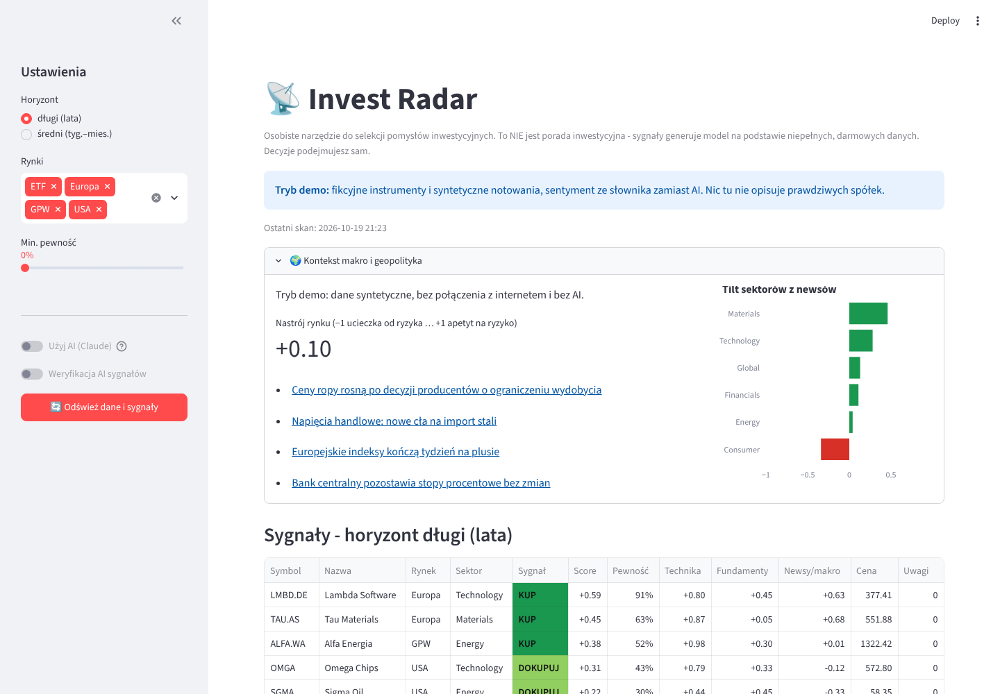
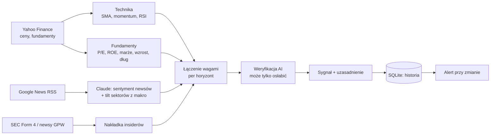

# Invest Radar

[](https://github.com/datapitch-dev/invest-radar/actions/workflows/tests.yml)

Osobisty skaner pomysłów inwestycyjnych. Pobiera notowania, fundamenty, newsy i transakcje insiderów dla
własnej watchlisty (GPW, USA, Europa, ETF-y), ocenia newsy i kontekst makro przez Claude API i składa z tego
sygnał KUP / DOKUPUJ / TRZYMAJ / OGRANICZ / UNIKAJ osobno dla horyzontu długiego i średniego. Zmiany sygnałów
mogą przychodzić jako alert na Telegram lub e-mail.



> To narzędzie pomocnicze, **nie porada inwestycyjna**. Darmowe dane bywają opóźnione i dziurawe, a model się
> myli. Nie składa zleceń. Czy sygnały cokolwiek przewidują, sprawdza `backtest.py` (niżej).

## Uruchom w minutę (tryb demo)

Tryb demo działa bez internetu i bez klucza API: fikcyjne spółki, syntetyczne notowania i prosty słownikowy
sentyment zamiast AI. Dobry do obejrzenia, jak działa całość.

```bash
python -m venv .venv && source .venv/bin/activate      # Windows: .venv\Scripts\activate
pip install -r requirements.txt
RADAR_DEMO=1 streamlit run app.py                      # Windows: uruchom_demo.bat
python scan.py --demo                                  # to samo w konsoli
```

## Normalne użycie

```bash
cp .env.example .env            # wpisz ANTHROPIC_API_KEY (opcjonalnie SEC_USER_AGENT, Telegram, e-mail)
streamlit run app.py            # Windows: uruchom.bat; w panelu bocznym "Odśwież dane i sygnały"
python scan.py --notify         # skan z konsoli/harmonogramu + alert o zmianach sygnałów
```

Bez klucza API też działa (technika i fundamenty, bez oceny newsów). Watchlistę, wagi i progi ustawiasz
w `config.yaml`.

## Jak powstaje sygnał



1. **Technika** (−1…+1): pozycja ceny względem SMA50 i SMA200, momentum 3 i 6 miesięcy, RSI. Zmienność i
   obsunięcie z ostatniego roku trafiają do flag ryzyka.
2. **Fundamenty** (−1…+1): P/E, ROE, marża, wzrost przychodów i zysku, zadłużenie (bez D/E dla banków).
   ETF-y nie mają fundamentów i nie są za to karane.
3. **Newsy i makro**: Claude ocenia sentyment nagłówków z pewnością oceny; analiza makro daje nachylenie sektora.
4. Składowe łączy się wagami zależnymi od horyzontu. Sygnał z mniej niż dwóch składowych albo o zbyt niskiej
   „pewności” spada do TRZYMAJ. Histereza progów nie pozwala sygnałowi migać wokół granicy.
5. **Weryfikacja AI** (sceptyczny recenzent) widzi gotowy sygnał i dane. Może obniżyć pewność albo zamienić
   sygnał na TRZYMAJ, nigdy go wzmocnić.
6. **Insiderzy** to nakładka na wynik: USA z formularzy SEC Form 4 (tylko zakupy i sprzedaże na rynku), GPW
   w przybliżeniu z nagłówków o transakcjach osób zarządzających (połowa wagi, oznaczone w dashboardzie).

„Pewność” to heurystyka (siła wyniku × zgodność składowych × pokrycie danymi), **nie prawdopodobieństwo**.

## Czy to działa? Backtest

```bash
python backtest.py technika --years 10    # test wstecz samej techniki na historii notowań watchlisty
python backtest.py historia --days 91     # co zrobiły ceny po sygnałach zapisanych przez kolejne skany
```

Wstecz da się uczciwie przetestować tylko technikę. Fundamenty z Yahoo to dzisiejszy zrzut, a RSS z newsami nie
ma archiwum, więc użycie ich na starych datach podglądałoby przyszłość. Backtest techniki liczy score z cen do
dnia t włącznie (to samo okno 2 lat co na żywo), wchodzi po zamknięciu następnej sesji i mierzy:

- **IC**: korelację rang między score a późniejszym zwrotem w przekroju watchlisty, z błędem standardowym
  i statystyką t. Przy |t| < 2 wyniku nie da się odróżnić od przypadku.
- **zwrot ponad średnią watchlisty** i odsetek trafień dla każdej akcji (KUP…UNIKAJ).

Ocena historii robi to samo dla pełnych sygnałów (z AI) zapisanych w bazie, po jednym na instrument i tydzień.
Oba testy pomijają koszty i podatek, a watchlista wybrana dziś zawiera tylko spółki, które przetrwały.

Wyniki na prawdziwych danych: *do uzupełnienia po pierwszym uruchomieniu `python backtest.py technika`.*

## Bezpieczeństwo i koszty

- Nagłówki newsów to dane niezaufane: prompt każe ignorować polecenia w ich treści, a odpowiedzi modelu są
  walidowane i przycinane do dozwolonych zakresów.
- Wyniki AI są cache'owane po treści (te same nagłówki lub ten sam sygnał nie generują nowego zapytania), więc
  odświeżenie bez nowych informacji nie kosztuje i nie zmienia sygnału.
- Klucze trzymaj w `.env` (jest w `.gitignore`). Dashboard nie ma logowania: uruchamiaj go lokalnie, nie
  wystawiaj portu do internetu.

## Alerty i harmonogram

`python scan.py --notify` wysyła wiadomość tylko przy zmianie sygnału: nowy sygnał do działania o pewności
≥ 40%, wygaśnięcie takiego sygnału albo przekroczenie progu pewności. Pierwszy skan i skany z błędami AI niczego
nie wysyłają. Kody wyjścia: 0 OK, 1 nie wysłano alertu, 2 błędy AI.

```bash
# Linux/macOS (crontab -e): pn-pt o 8:30
30 8 * * 1-5  cd /sciezka/invest-radar && .venv/bin/python scan.py --notify >> data/scan.log 2>&1
```

```bat
:: Windows: Harmonogram zadań
schtasks /Create /SC DAILY /ST 08:30 /TN "InvestRadar" /TR "cmd /c cd /d C:\sciezka\invest-radar && .venv\Scripts\python.exe scan.py --notify >> data\scan.log 2>&1"
```

## Struktura

```
app.py              dashboard (Streamlit)
scan.py             skan z konsoli, alerty
backtest.py         backtest techniki i ocena historii sygnałów
config.yaml         watchlista, wagi, progi (config.demo.yaml: fikcyjna watchlista demo)
radar/
  pipeline.py       orkiestracja skanu, cache wyników AI
  signals.py        łączenie składowych, histereza, weryfikacja
  indicators.py     technika        fundamentals.py   fundamenty
  ai.py             Claude API      insiders.py       SEC Form 4 i GPW
  alerts.py         wykrywanie zmian, Telegram, e-mail
  backtest.py       metody oceny    storage.py        SQLite: cache i historia
  data.py           Yahoo, Google News                demo.py   dane syntetyczne
  runtime.py        składanie zależności z konfiguracji
tests/              testy jednostkowe i integracyjne, bez internetu
```

Każda zależność zewnętrzna (ceny, newsy, model, baza) jest wstrzykiwana, więc cały skan da się przetestować na
danych syntetycznych: `python -m unittest discover -s tests -t .` (CI uruchamia też ruff, skan demo i backtest demo).

## Licencja

MIT
